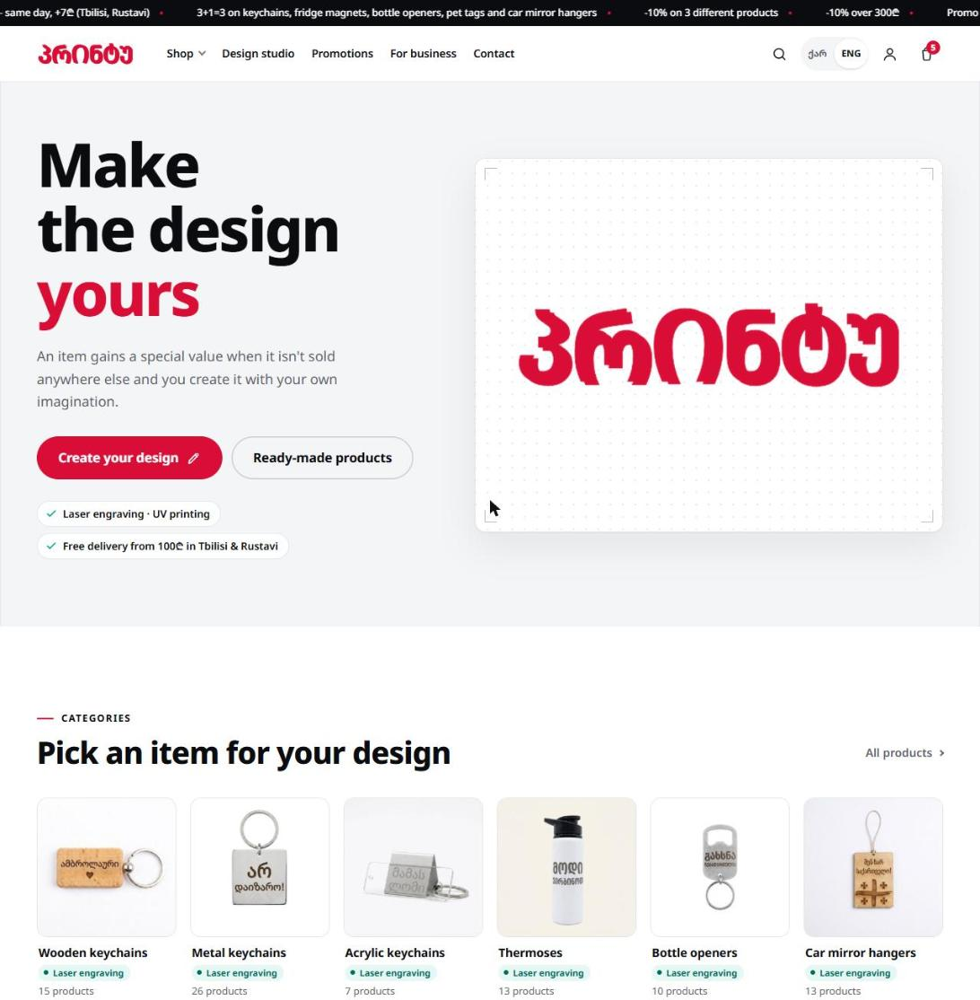
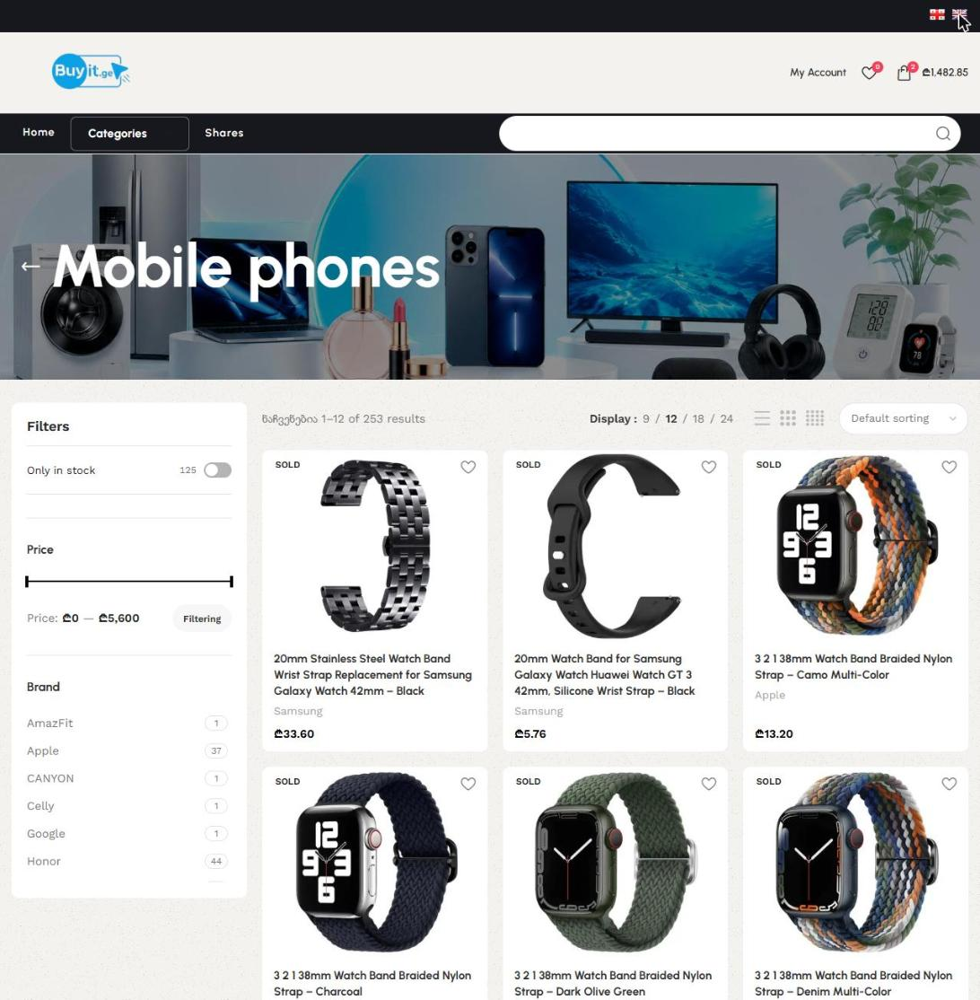
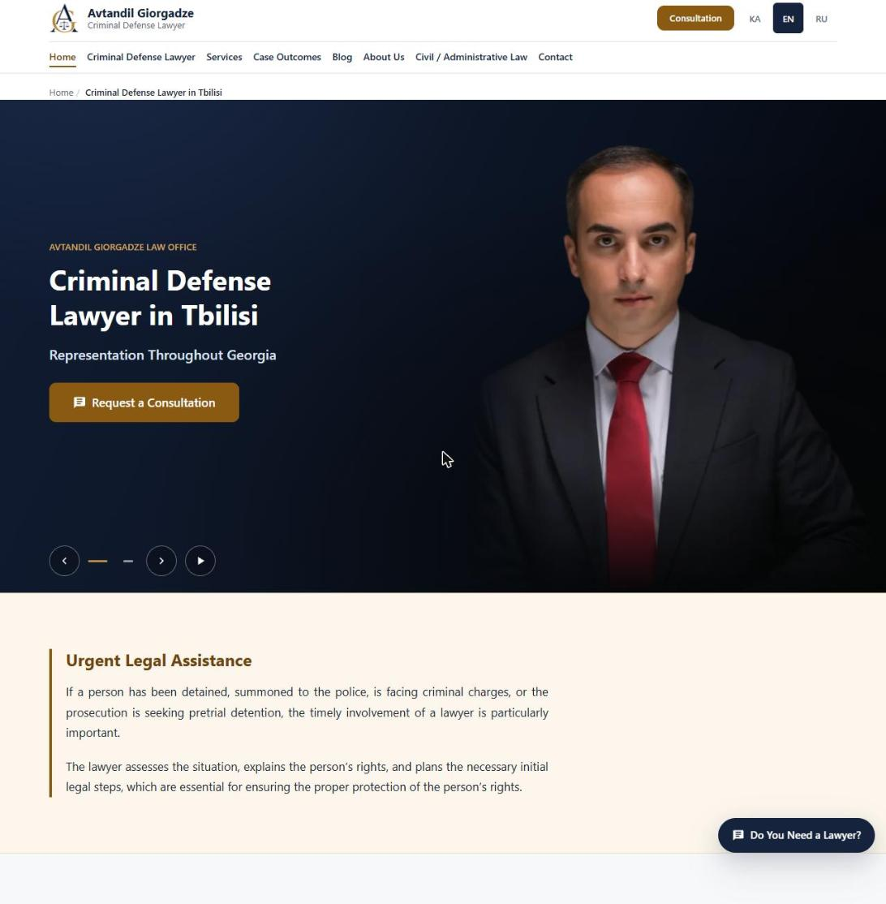
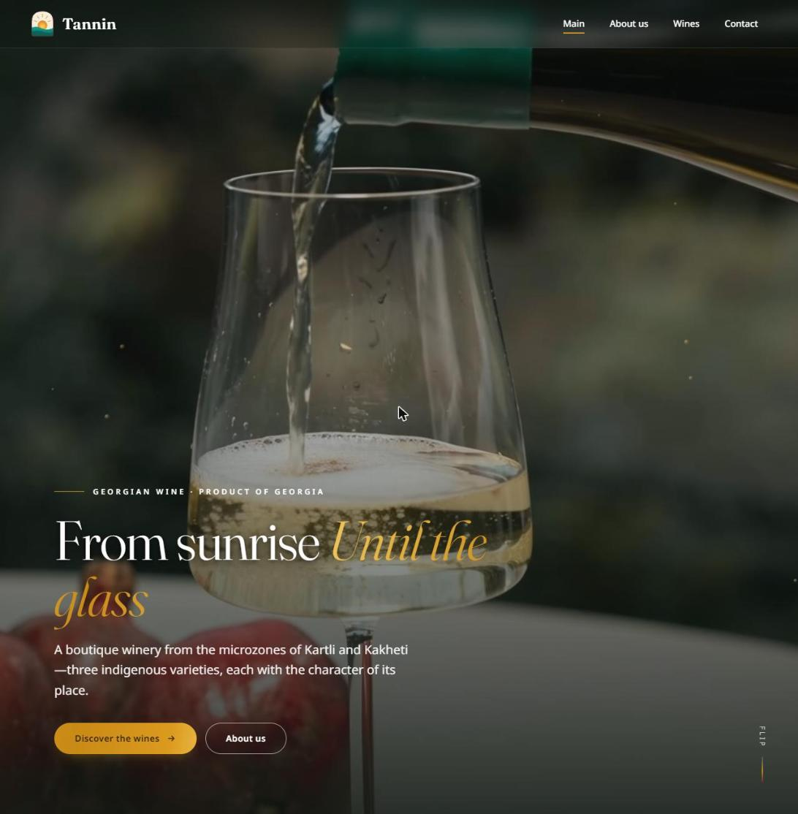

# Hi, I'm Aleksandre 👋

**WordPress & WooCommerce developer from Tbilisi, Georgia.** I build fast, SEO-ready business websites and online stores that are easy for clients to manage.

- 🛠️ WordPress (custom themes and Elementor), WooCommerce, PHP, JavaScript, HTML5, CSS3
- 🚀 Page speed optimization, Core Web Vitals and on-page SEO
- 🌍 Multilingual websites (English, Georgian, Russian)
- 🎓 Best Web Programming Graduate of 2024, FlashSkill College

## Selected work

### Custom-design e-commerce store (WooCommerce)
Bilingual store with an in-browser design studio, 18+ product categories, cart, checkout, customer accounts and promo codes.

### Electronics store (WooCommerce + Elementor)
Deep multi-level catalog, product filters, search, wishlist and customer accounts.

### Law firm website (WordPress)
Trilingual website with 30+ pages: a dedicated SEO landing page for each legal service, case results, client reviews and a legal blog.

### Event website with ticket sales (WooCommerce)
Custom theme with ticket sales, a leaderboard, event pages, galleries and a merch shop.

### Boutique winery website (WordPress + Elementor)
Image-led bilingual website with a page for each wine and a brand-story section.

> Client source code is private and is not published here. Screenshots are shown with contact details removed.

## Work with me
I take on new projects through Upwork: [View my Upwork profile](https://www.upwork.com/freelancers/~0184fcf211fee5204c)
